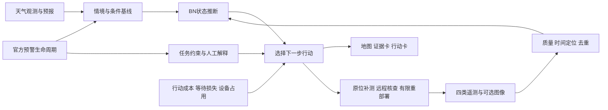

# GridScout：实时状态孪生与决策网络设计稿

日期：2026-10-24。状态：实时孪生已扩展为动态闭环调度、模拟检查和人工交接；本文件记录设计边界，未接入真实遥测或验证硬件性能。

已实现：七类合成情景（原有六类加动态任务）、冻结正常基线、四路窗口流、天气与预警生命周期、当前窗口 BN、成本敏感核查、五机动态调度与检查、候选无人机比较、计划变更与检查发现解释、明确人工请求、Dashboard 和审计导出。默认界面开启自动模式，演练时钟推进后执行任务；旧版手动实验和工作区保留。真实天气适配器、工程精度 3D、未来故障预测和硬件集成为后续工作。S4 断电语义已在数据/任务约束中处理，当前未提供独立运行开关事件回放。传感漂移在不同随机种子下尚不能稳定识别，评估结果保留此限制。现有六情景快照评估明确排除动态任务，保持设备静止，不用于证明自动任务的效果。

## 1. 本轮确定的边界

- 用户已向发起人确认支持实时回传，但本次无法取得数据契约或样例；开发不以取得接口为前置条件。
- 用户确认已有传感器类别：温度、振动、电压、倾斜角度。具体测量对象、安装方式、精度、频率及单位尚未知。
- 用户提供当前无人机质量为 3.8 kg，可增加传感器但不超过 250 g。本提案保守地按“每台全部新增传感器、外壳、支架、线束、电源/接口的合计增重不超过 250 g”设计。
- 地理底图使用现有官方包的 64 段线路、59 个映射节点。地图连接不是经过验证的电气连接；没有真实客户供电关系。
- 保留现有演练规则：五台设备、单次飞行上限 30 分钟、每次飞行后完整充电 180 分钟、任务窗口 240 分钟。停驻测量可与充电重叠。新增质量不用于擅自修改这些规则。
- 用户进一步确认最高飞行速度为 60 m/s（216 km/h），且最高速度下数据质量较差。日常 20 m/s、高优先级 40 m/s、紧急 60 m/s 为演示调度策略假设；高速转场数据不进入线路状态 BN，抵达稳定停驻后采集检查证据。速度上限不会覆盖天气、30 分钟飞行和 180 分钟充电约束。
- LINE_024 在官方练习中已知被预防性断电；断电不等于损坏，不允许作为充电位置。
- 本轮遥测、运行记录、天气过程及预警事件均使用同一演练时钟的假设情景。未来真实天气适配器单独接入；不得把今日真实天气与虚构事故拼接后标为真实事件。

目标：在正常天气/运行变化下减少不必要的昂贵核查，同时控制关键异常漏检和确认延迟；展示每个行动的证据、代价、替代方案与复核条件。

## 2. 最小产品和主案例

首版主案例为“强风下的线路机械异常核查”，同时保留温度与电压背景信号。它不依赖尚未确认的电流测量，可以展示四类现有信号、天气证据和可选图像核查的作用。

核心故事：预警提高关注度 → 风增强、多个位置的振动同步增加但符合条件基线 → 风减弱后某段线路仍有持续振动异常与倾角偏移 → 检查测量质量和安装状态 → 补充视觉证据/人工复核 → 决定继续观察或现场升级。

天气导致的正常响应与天气导致的损伤风险必须同时存在于模型中。符合正常基线不能覆盖已知工程限值；限值本轮仅可作为明确标注的场景输入，不作为真实飞行或电气运行标准。

## 3. 数据语义与扩展载荷

| 字段/测量 | 首版模拟语义 | 禁止的推断 |
| --- | --- | --- |
| conductor_temperature_c | 假设为稳定停驻时的导线接触温度；明确假设标签 | 不把未说明来源的 temperature 自动认作导线温度 |
| vibration_features | 模拟生成的窗口强度、频带能量和持续性特征；不声称来自实测高频原始波形 | 不把飞行旋翼振动当成线路损伤 |
| tilt_delta_deg | 相对同安装条件下参考姿态的偏移 | 不直接换算绝对弧垂、净空或杆塔倾斜 |
| voltage_proxy | 假设为线路相关的带电状态代理观测，含噪声与缺失 | 不等同铭牌 voltage_kv，不推出电流、负荷或可充电功率 |
| ambient_temperature_c / relative_humidity_pct | 可选新增环境测量；有机体/日照影响的质量标记 | 不把机体或充电热源温度当作环境温度 |
| visual_evidence | 可选 RGB 核查；有视角、遮挡、资产匹配与人工判断 | 未看到异常不等于没有异常 |
| load_state | 默认 unknown；特定演练分支可接收模拟运行遥测 | 不用电压值估算负荷，不能把模拟器真实负荷泄漏给 BN |

初步新增载荷预算（设计上限分配，非产品称重或已完成选型）：

| 项目 | 预算 |
| --- | ---: |
| 环境温湿度测量组件 | 20 g |
| 轻量 RGB 成像组件；已有可用相机时复用 | 80 g |
| 接口、电源转换、线束及必要处理组件 | 40 g |
| 外壳与安装结构 | 60 g |
| 工程余量 | 50 g |
| 合计上限 | 250 g |

目标为已分配集成质量不超过 200 g，保留 50 g。3.8 kg + 0.25 kg = 4.05 kg，仅是质量核算（约增重 6.6%），不是适航、重心、功耗或航时验证。

首版优先环境温湿度与视觉核查。若改为热异常主案例，可重新分配预算选择辐射测温热像；不能在 RGB 预算之外默认再叠加热像。烟气/颗粒物传感器留给明确的野火案例，以免引入难以解释的工业污染和采样位置影响。

## 4. 外部数据的三种角色

| 来源 | 用途 | 第一版处理 |
| --- | --- | --- |
| 天气观测/站点数据 | 解释当前温度、振动等正常变化 | 合成观测；包含空间代表性、延迟与缺失 |
| 天气预报（可选 DWD MOSMIX 或 ICON-D2） | 估计未来天气分布、损伤风险、提前部署和可飞行窗口 | 合成预报；与模拟器实际天气可以不同 |
| 官方预警（可选 DWD CAP） | 区域事件、严重度、有效期、更新/撤销以及人工解释 | 合成预警；不冒充 DWD 实际发布 |
| 运行/开关记录 | 解释带电状态改变；可选负荷背景 | 显式假设消息，不能从地图或电压反推 |

优先为德国场地预留 DWD 适配器：MOSMIX 点预报适合先验证时间语义与数据管线；需要更细空间表达时评估 ICON-D2；CAP 单独解析预警生命周期。历史 CDC 天气可帮助构建天气条件分布，但不能替代健康线路的传感器基线。

每条外部消息至少保留：source、record_id、event_id、issued_at、received_at、valid_from、valid_to、geometry/location、units、quality、version/references、synthetic 标记；缺失结束时间时显式表示 unknown，并使用已记录的过期处理规则。

每条遥测至少保留：observation_id、sensor_id、asset_id、observed_at、received_at、window_id、measurement_kind、value/features、unit、device_mode、quality、baseline_version、synthetic 标记。

当前状态只使用决策时刻已经收到且适用的证据；未来有效的预报用于未来分支，不能冒充当前实测。回放不能偷看后来发布的预报修订。

预警更新、撤销和多语言副本按事件及引用关系处理。撤销天气预警不会删除已观测到的资产异常。无预警不是无风险，预警区域覆盖也不是具体线路受损证据。

### 避免重复计数

预报和预警可能来自同一模型/天气事件，不能视为两份独立故障证据。首版采用明确的优先规则：有有效数值预报时，使用它形成天气先验，预警用于情境和行动约束；仅有预警时，映射为宽泛的假设天气分布。不要在同一先验上再次乘预警似然。两者冲突时显示冲突、扩大情景范围并请求复核，不生成未经校准的精确融合概率。

未来若建立联合天气模型，可按来源依赖建模后融合；不能仅靠不同 record_id 假定独立。振动与倾角也可能来自同一 IMU/共同风扰动，应采用联合机械观测似然或共享潜变量。

## 5. 条件基线与 BN

基线由独立的、已标注为健康的合成历史片段建立，覆盖风、日照、负荷和安装条件，记录 baseline_version。演示期间冻结基线；设备重新安装后，姿态基准需要重新建立。未知工况进入不确定性或分布外状态，不被自动解释为故障或正常。

- 温度基线：环境温度、风、日照、负荷/负荷未知、资产参数及安装热影响。
- 机械基线：风速/阵风、资产和安装条件、稳定停驻模式；联合刻画振动及倾角。
- 电压代理基线：已知运行/开关状态和测量质量。掉电可由运行操作引起，不自动表示损坏。
- 邻线数据可以辅助判断共同天气变化，但不能默认邻线健康或把空间相关读数当作独立确认。

首版 BN 采用当前窗口重新计算，窗口 ID 去重；例如使用不重叠 60 秒窗口，这是可调的演示假设。不把每秒读数反复乘入上一秒后验。后续需要时再加入显式状态转移构成动态 BN。

静态窗口 BN 只估计当前资产状态。第一版未来视图默认展示天气危险度与任务可行性；若增加未来资产风险，必须另设显式假设的单步前向投影 P(S[t+h] | S[t], future_weather)，由当前状态分布积分得到，且不回灌当前后验。此投影与跨窗口动态滤波是不同功能。

建议变量：

| 变量组 | 内容 |
| --- | --- |
| 条件/背景 | 当前局地天气分布、运行/开关状态、负荷或负荷未知、资产属性 |
| 资产潜在状态 | mechanical_condition、thermal_condition；带电状态单列，允许损坏与带电状态不同 |
| 测量质量 | sensor_health、installation_state、device_mode；有效/陈旧/缺失 |
| 观测 | 温度条件特征、联合振动与倾角特征、电压代理、可选视觉证据 |
| 输出 | 当前各异常状态的模型后验、正常替代解释和证据缺项；未来资产风险仅由可选独立前向投影提供 |

主要统计依赖：

- 当前天气与负荷共同解释温度；热异常和测量质量也影响温度观测。
- 当前天气与安装状态共同解释机械响应；机械异常和测量质量也影响联合机械观测。
- 运行/开关状态影响带电状态，带电状态与质量影响电压代理；电压不直接作为温升负荷解释。
- 未来天气分布影响未来状态转移和任务可行性，不直接确认当前损伤。
- 安装偏移或传感器漂移可以与资产异常共存，不能仅因发现传感问题就断言资产正常。

正常数据只确定正常观测模型；故障先验、异常似然和传感失效模型使用公开记录的假设参数。没有实际校准，不能宣称后验是实测可靠故障概率。派生残差与其原始输入也不能作为两份独立证据重复输入。

## 6. 决策网络与反馈

BN 推断状态，决策层选择行动；决策层接收后验与任务约束，并关联行动成本和结果损失。

以上为信息流图，不将预警本身解释为引起损坏的物理原因。

候选动作：继续监测、原位补测、检查测量/安装、请求远程图像核查、移动一台设备、建议现场核查、紧急人工升级。各动作都有用途、时间、资源占用和结束/复核条件。

最小策略比较每项可行动作的期望总损失：行动成本 + 误判与事件损失 + 等待/延迟损失 + 设备占用代价。成本分项需明确，不能重复计入同一损失。取证动作应枚举可能结果并比较之后最优动作的预期损失；核查的价值是改变决策，不能只用熵下降替代。

成本采用可调的假设区间，不声称真实节省金额。约束包括充电、飞行、观测范围、传输可用性，以及情景定义的天气操作包线。区域预警不自动等于禁飞；停驻和飞行分别判断。运行包线未经厂商确认时只用于演练。

180 分钟充电期间的停驻观测可继续，但再次移动受限；计划应计入未来重部署能力的占用。五台设备不被表现为持续巡飞。高后果紧急证据允许立即人工升级，不强制等第二种传感器确认。

### 当前自动任务实现

默认 Dashboard 打开 **Automatic dispatch & inspection**。时钟初始暂停，点击 Play 或 Advance 后，系统按“任务排队 → 可行性检查/等待 → 飞行或原位检查 → 收到模拟检查证据 → BN 更新 → 继续监测或人工请求”推进。控制器只访问公开报告、已收到的观测和当前任务状态，不读取场景注入标签或未来真值。

初始报告只构成任务种子。控制器持续根据已收到的异常、检查结果、报告版本、当前覆盖和设备约束重估尚未执行的任务；同一目标比较五台无人机，并记录选择理由、其他候选被排除或延后的原因。新证据可以调整优先级、换用另一台合适无人机，报告更正可以替代旧目标，撤回消息可以取消相应排队任务。已经起飞的航段保持原目的地和充电承诺，避免凭空改变续航状态。候选飞行目标仍限于显式假设的可充电站点；已有异常或不确定性的出发点需要保留观测或显示离开代价。这是可解释的滚动任务启发式，未实现全局最优路线、全场覆盖或最优成本证明。

动态任务情景保留原始五个出发点。公开报告于 T+20 请求核查 LINE_028，T+29 更正为 LINE_002，T+32 撤回；每条消息保留 issued_at、received_at、request_id、event_id 和版本关系，仅到达后才可影响决策。T+46 收到新的 LINE_058 高优先级线索，T+50 收到 LINE_015 关联后续线索，并显式要求先获得 LINE_058 检查结果。结果支持、未见或不确定时，系统重新评估后续任务，解释优先级和分配的变化。关联只表示公开报告的地理调查关系，不表示已验证的电气连接，也不将线索优先级当成故障概率。具体到达、检查和派遣时刻由当前速度、天气、充电和任务状态计算。

每次自动检查假设需要 4 分钟，生成可支持异常、未见异常或不确定的合成视觉证据。成像能力仍属于可选载荷假设，实际没有执行图像识别；有用图像条件下的灵敏度 0.85、特异度 0.92，以及不确定结果概率 0.12 均是演示参数。检查可与停驻充电重叠；新视图通过现有接口进入 BN，15 分钟后过期。

检查结束后，Dashboard 描述收到的视图结果和仍缺少的证据，使用同一个遥测窗口展示加入该视图前后的 BN 概率，避免把时间推进带来的变化归因于检查。未见可见异常可以降低概率，但不能覆盖持续遥测异常或证明资产健康。检查结果和后续新证据可以触发有次数、间隔或复核时限约束的再次检查；恢复后的新一轮异常可创建新事件，并保留先前事件记录。

持续异常以三个不同的已收到窗口作为触发门槛；窗口持续性不会作为三份独立似然重复乘入 BN。当前决策已经支持现场核查时，持续性门槛达到后即可向人发出请求，额外检查继续进行，不延迟交接。严重观测可直接触发紧急请求。通信缺失或持续传感器问题达到 5 分钟、持续未决异常达到 10 分钟，以及任务受阻超过自身复核时限时，也会给出具体人工请求；这些期限均是场景参数。

人工请求包含资产、原因、所需动作、创建时间和相关检查。**Acknowledge** 仅表示有人接收，不能清除故障、宣告修复或关闭案件。软件持续监测，不执行维修、不恢复供电。关闭自动模式后，已在飞行或检查的任务完成，排队任务等待；手动控制用于探索情景。默认 UI 开启自动模式；程序接口默认关闭，以保持原有静止快照评估可重复。

## 7. 场景与验收

合成器独立生成真实天气、资产状态、传感器偏差、运行操作和观测噪声。政策只能看到已到达的消息；隐藏真值仅供离线评估。测试包括与 BN 假设不同的噪声、先验、延迟及空间相关，避免使用同一模型自证正确。

| 场景 | 注入情况 | 应展示的行为 |
| --- | --- | --- |
| S0 正常 | 健康资产、常规天气与负荷变化 | 条件基线跟随正常变化，保持监测 |
| S1 强风无损伤 | 预报和预警描述同一事件；振动与瞬时倾角增加 | 不重复计数；提高未来关注但不凭预警确认损伤 |
| S2 持续机械异常 | 风减弱后某段线路仍异常；可追加合成视觉证据 | 展示支持/反对解释，必要时核查和升级 |
| S3 正常温升与热异常对照 | 分别注入负荷上升和额外热异常；负荷有/无信息 | 有背景时解释正常变化；缺背景时保留不确定性 |
| S4 预防性断电 | 官方 LINE_024 状态或独立演练开关事件 | 带电与损坏分开；禁止由电压/地图推断可充电 |
| S5 传感问题 | 漂移、安装变化、飞行振动、通信丢失 | 检查质量；过期和缺失显示未知，不能填零 |
| S6 预警生命周期 | 旧预报、重复消息、更新/撤销、空间错配 | 正确筛选时间区域；撤销预警不清除资产异常 |
| S7 动态闭环任务 | 更正和撤回的线索、后续新线索、随时间变化的资产状态、关联检查请求 | 更新排队任务、比较五机并重新分配；检查结果改变后续优先级，已起飞航段保持承诺，必要时人工介入 |

验收重点：

- 在相同关键异常召回/延迟约束下比较不必要昂贵升级次数与假设成本。
- 对比不看天气、条件基线+BN、再加入行动价值的策略；保留简单监测基线，允许新策略表现更差。
- 记录关键异常发现/升级延迟、漏检、未决案件与复核时限、总行动和传感器占用。
- 去重、预警撤销、缺失、场景时钟、重复时间窗和天气/传感相关证据检查。
- 官方映射数据没有故障真值；所有准确率和成本效果仅属于合成实验，不归因于真实 Bavaria 电网或 Nomadic 硬件。

## 8. Dashboard 与实施顺序

主界面优先显示“是否需要人行动、五台无人机正在做什么、下一步何时发生”。顶部人工请求卡给出明确动作与理由；设备卡显示航路、到达/充电时间或原位检查。地图用虚线路径、已行进路径和目标圈表达调度过程，任务卡显示排队、受阻、飞行、检查及倒计时，时间线保留已发生的阶段和结果。灰色未知与异常分开，未覆盖位置不会因为暂无报警而变绿。

点击 **Load dynamic mission** 后使用 Play 查看过程，或 **Jump to 55 min** 查看已积累的决策，再推进到后续结果。首页突出最近一次计划变更的触发证据和实际影响；选中任务可比较五台无人机的资格、预计耗时、选择或排除理由，查看检查发现、同窗口概率变化与人工要求。公开消息接收时刻固定，航程和检查结束时刻应读取运行结果，不能在讲解中假定固定到达时间。

**Follow priority asset** 默认跟随未处理人工请求或活动检查；关闭后使用资产选择器自由查看。天气、基线、BN 细节和审计置于各自标签页，手动检查/迁移控制收纳在折叠区。只在必要时展开详细模型信息，操作员可以先看到当前需要做什么。

选中线路显示四类观测、条件基线和正常区间；展示天气发布时间/有效期、设备模式，分开显示当前资产状态与未来天气危险度/任务可行性。只有实现独立前向投影后才展示未来资产风险。右侧分别给出证据卡和行动卡，说明为什么行动、为什么现在、为什么不是更便宜的核查，以及何时复核。

3D 先用于选定线路的局部示意（振动或相对倾角变化）；没有高度/跨距/安装标定数据时不输出真实弧垂或净空。全场地二维地图优先。

实施批次：

1. 合成数据结构、四类信号的测量语义、场景时钟及独立隐藏真值；已有官方包保持原样。
2. 一条线路的条件基线、联合机械证据与当前窗口 BN；完成正常强风/持续机械异常对照。
3. 加入天气/预警适配层、生命周期、时空匹配与来源相关规则；先离线合成，真实数据作为可选适配器。
4. 扩展五台设备、充电和观测状态；接入行动成本/结果分支，建立证据与行动审计。
5. Dashboard 和配对情景评估；再决定是否做局部 3D 与第二种故障案例。

建议新增独立模块 synthetic_telemetry.py、weather_context.py、conditional_baseline.py、asset_inference.py、action_policy.py，避免把现有单次二元观测接口强行当成连续流模型。可复用 official_data.py 的资产标识、地图和原包校验，以及现有调度/审计的已验证约束。

## 9. 参考与证据状态

- 用户本次确认：实时回传、四类已有传感器、3.8 kg 机重、250 g 新增传感器限制、最高速度 60 m/s 且最高速度下数据质量较差；其余集成、巡航策略与信号参数均为设计假设。
- [官方本地数据说明](data/official/README.md)；[当前挑战模型](OFFICIAL_CHALLENGE.md)。
- [DWD MOSMIX 方法说明](https://www.dwd.de/DE/leistungen/met_verfahren_mosmix/mosmix_verfahrenbeschreibung_gesamt.pdf?__blob=publicationFile&v=6)：点预报、气象变量及概率预报背景。
- [DWD MOSMIX 参数](https://www.dwd.de/DE/leistungen/met_verfahren_mosmix/mosmix_parameteruebersicht.pdf?__blob=publicationFile&v=3)：变量及时间区间语义；接入时需验证单位与缺失值。
- [DWD CAP 文档](https://www.dwd.de/DE/leistungen/opendata/help/warnungen/cap_dwd_profile_en_pdf_2_1_14.pdf?__blob=publicationFile&v=2)：预警标识、时效及更新/撤销关系。
- [DWD CAP 数据目录](https://opendata.dwd.de/weather/alerts/cap/)；[DWD CDC 说明](https://opendata.dwd.de/climate_environment/CDC/Readme_intro_CDC_ftp.pdf)。
- [Sensirion 环境温湿度设计指南](https://sensirion.com/resource/user_guide/sht/design_in)：安装热源隔离等测量设计要求，非本机集成验证。
