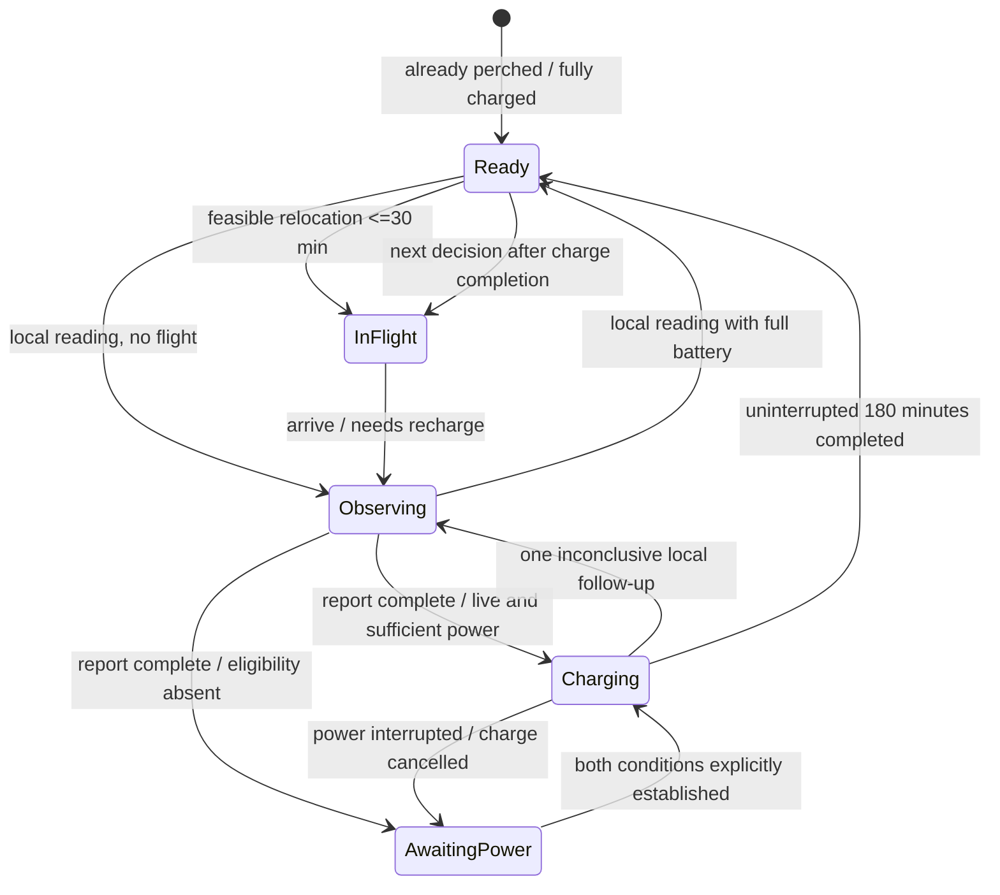

# Official Nomadic Drones challenge integration

## Public sources

The original participant package is stored unmodified in `data/official/`: 64 line segments, 59 mapped nodes, six fictional reports, spatial context, public configuration, original README and overview PNG. `manifest.json` records the archive SHA-256 and every imported file digest. Loading verifies these digests before building the map. Source: [Nomadic Challenge: Keeping the Power Flowing](https://app.notion.com/p/nomadicdrone/Nomadic-Challenge-Keeping-the-Power-Flowing-400b293a19d8818fb466caf01a743ed6).

© OpenStreetMap contributors. The adapted grid dataset is distributed under ODbL 1.0, as stated in the organizer README. Fictional storm/report material is identified separately. No export date or operational grid status is inferred from the map.

Use geographic `from_node`/`to_node` associations without inventing electrical bus connections. A NetworkX MultiGraph preserves all 64 segments, including eight parallel endpoint pairs. Seven component IDs represent mapped adjacency, not seven outage/service zones. There are no supplied customer counts, power flows, capacities, live states or charging-power measurements.

## What is known and what is assumed

| Item | Status |
| --- | --- |
| Segment/node IDs, line geometry and voltage tags | Official mapped data |
| Six storm reports and broad report polygons | Official fictional exercise material, all available at t=0 |
| LINE_024 de-energized | Known within the official exercise, from SYN_REPORT_03 |
| Damage on LINE_024 | Unknown; precautionary switching is not failure confirmation |
| Other energized/power states | Unknown unless explicitly assumed in the demo |
| Twelve default eligible charging sites | Explicit demo assumptions, visible/editable in the UI |
| Five initial positions and full initial batteries | Explicit deployment assumptions |
| Sensor readings after mission start | Clearly labelled hypothetical examples; no organizer truth is present |
| Customers, hospitals, outage kW and restoration outcomes | Not provided; not calculated for the official case |

Conservative charging mode removes all unverified charging assumptions. Initial full-battery perched readings still work. With terminal visits disabled, no relocation to unknown charging sites is permitted. This intentionally exposes the value of missing operational status rather than guessing it from a voltage tag.

## Operational state machine

Charging begins on arrival, concurrently with the five-minute perched observation when eligibility is established. The sensor's charging clock remains separate from its observation state. Every flight, even a brief hop, requires a full 180-minute recharge before another flight. A sensor that lands at an unknown or noncharging site can measure but cannot depart again without satisfying the recharge requirement. Optional terminal visits expose this tradeoff; default dispatch requires a charge-eligible destination.

When power is interrupted, the model cancels the charging timer and conservatively restarts a full 180-minute interval once both conditions return. Previously elapsed charge is not credited. Status updates are explicit operator/demo assumptions and are logged. LINE_024 cannot be re-energized through this UI because no switching or repair operation is simulated.

The mission clock advances to flight arrivals, observation completions or charging completions. Assignments are nonpreemptive and exclude simultaneous duplicate targets. Measurements need not wait for charging to finish. The horizon is 240 minutes, from the public configuration; charging extending beyond it remains unfinished. Instruments are assumed to have enough low-power perched measurement endurance for the four-hour window. Initial deployment lies outside the window.

## Evidence and decisions

All six initial reports are loaded once. Report polygons are matched against full line polylines, including crossings of the polygon boundary. Their original timestamps do not trigger later arrivals of information.

Initial anomaly beliefs are illustrative: a shared geographic severity prior (Low/Medium/High) of `(0.10,0.35,0.55)` reflects report 01. For severity index `s=0,1,2`, conditional probability is `sigmoid(-3.4 + 1.1*s + report offsets)`. Reports 02–06 contribute offsets `0.35,0.20,0.10,0.30,0.25` once to spatially intersecting lines. Weak offsets reflect incomplete evidence but are not calibrated from data. Geographic West/Central/East bands are modeling assumptions independent of mapped components.

Positive/negative hypothetical readings reuse the exact Bayesian inference module, fixed sensitivity/specificity and shared-zone propagation. Inconclusive outcomes are explicitly modeled as uninformative (likelihood one) and do not change beliefs. One in-place follow-up is allowed. The auto-run generates reproducible posterior-predictive examples from keyed random variates; it contains no hidden fault truth and cannot measure official fault accuracy.

The default policy combines candidate-normalized anomaly risk and expected severity information gain per flight-plus-measurement minute. Charging is a hard constraint. This is an investigation heuristic, not restoration optimization. Risk-only and reproducible Random are alternative public-information policies. Initial placement balances illustrative report scores and geographic spread.

Operator advice distinguishes collect evidence, seek additional evidence, recommend operator/field inspection, and continued monitoring. A positive example supports verification; repair requires identified faults and operator authorization.

## Default reproducible demonstration

Start positions (seed 42 / default assumptions):

| Sensor | Initial segment |
| --- | --- |
| Sensor 1 | LINE_026 |
| Sensor 2 | LINE_054 |
| Sensor 3 | LINE_036 |
| Sensor 4 | LINE_064 |
| Sensor 5 | LINE_009 |

1. Open the default Official challenge workspace and review the six initial reports.
2. Highlight LINE_024: de-energized, charging prohibited, damage unknown.
3. Execute an inspection with an inconclusive or seeded hypothetical result. Inspect unchanged/updated beliefs and recommended evidence collection.
4. Advance events or auto-run. The audit shows flights, 180-minute charge intervals and the next permitted departure.
5. Optionally switch to conservative charging and show the consequence of lacking confirmed live/power information.
6. Export the mission JSON with source reports, status assumptions and event history.

The Synthetic laboratory remains available for the earlier service-impact model and paired benchmarks; its customer metrics and hidden simulated faults are not attributed to this official map.
