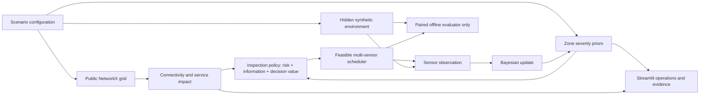

# GridScout V3

The additional **Route showcase** replays the teammate's exported schedule on
the same Bavaria map: 56 travel legs, 184.681261 km, and the reported line
coverage. Open **Route showcase** in Streamlit or the website navigation, or
open `dist/schedule.html` directly. Playback supports seeking, stepping and speed
selection; the route page contains no evidence or Bayesian explanation panels.
The bundled input is `data/schedules/teammate_output.txt`; `LINE_024` remains
unreported in its coverage list. Rebuild both self-contained pages with
`python web/build.py`. To regenerate the intermediate JSON, run
`python -m gridscout.schedule_replay`. The route page can also be rebuilt
independently with `python web/build.py --route-only`.

## Judge showcase — P0 delivery

The default entry is a self-guided 105-second synthetic replay with nine
chapters. It starts with the received LINE_058 report and a stationary RGB
inspection by Drone 4 from adjacent LINE_025, about 7.3 m away. Drone 4 keeps
charging. The T+47–51 camera check avoids a redundant flight, but supplies no
contact telemetry for LINE_058. That line stays **Unknown**, with a human
coverage request for follow-up.

The story then follows Drone 5 on a distinct LINE_015 follow-up: it leaves
LINE_009 at T+52, arrives at T+78 and completes a four-minute stationary RGB
inspection at T+82. This target has its own received telemetry, so the replay
shows the same-window BN calculation: context prior **4.94%**, sensors
**0.100%**, then sensors plus the received **clear** RGB view **0.058%**.
LINE_015 is **Normal**, with continued monitoring recommended. The flight is
needed to collect this target's evidence; it does not duplicate Drone 4's
nearby image check.

**View this step's evidence** pauses playback and opens the matching asset/time
snapshot in Dashboard. Dashboard contains operations, baseline, Bayesian
calculation, weather and audit panels. Validation reports the current model's
six-scenario stationary evaluation separately from the dynamic story.

The GitHub Pages edition is an offline-capable, read-only replay and evidence
viewer. The complete mutable Python workspaces remain available under
**Interactive dashboard** when running `app.py` locally. The replay does not
issue real drone commands or represent field-calibrated probabilities.

Rebuild and preview from this project directory:

```powershell
.\.venv\Scripts\python.exe -m gridscout.showcase_data
.\.venv\Scripts\python.exe web/build.py
.\.venv\Scripts\python.exe -m http.server 8510 --bind 127.0.0.1 --directory dist
```

Open http://127.0.0.1:8510/. The self-contained `dist/index.html` also opens
offline. `python -m streamlit run app.py` opens the showcase and interactive
workspaces together. Version-bound public evidence is stored in
`artifacts/showcase_data.json` and `artifacts/validation_summary.json`.

The older `artifacts/twin_validation.json` is a historical BN 1.0 report; the
current P0 release uses the regenerated BN 2.0 aggregate above.

**Adaptive Grid Inspection & Restoration Intelligence**  
Hackathon challenge: **Nomadic Drones — Keeping the Power Flowing**

## Live digital twin (default, upgraded 24 October 2026)

Click a BN node card to highlight its direct parents, children and connecting edges. The node panel shows its definition, snapshot probability or observed value, and calculation basis. The node selector supports keyboard navigation; **Show all** restores the overview. This explorer uses an independent interface fragment with the selected evidence snapshot.

Select **Inspect asset**, then open **Decision network** for the line's probability explanation. Manual asset selection disables automatic priority following. The view shows the manually specified BN variable dependencies and a separate decision workflow. It includes measured values, conditional baseline intervals, branch residuals, context priors and prior → sensor-only → eligible-inspection posteriors. Known operating records fix the energized state; unknown records enumerate both operating states (16 joint states versus eight with a fixed record). Choose a historical inspection to replay its exact frozen evidence and same-window probability change, even after that inspection expires. Hypothetical inspection previews change no mission evidence or task.

The probability timeline records individual observation windows and inspection events; missing or departed observations create Unknown gaps. This is still a current-window BN. A recursive DBN is deferred because observation residuals are correlated and state transition/recovery rates lack field calibration; see [BN_TEMPORAL_DESIGN.md](BN_TEMPORAL_DESIGN.md) and the six-seed diagnostic in `artifacts/temporal_model_assessment.json`. Temporal persistence gates continue to influence scheduling without multiplying historical posteriors.

The application now opens in **Digital twin · Live simulation**. It uses the official 64-segment Bavaria map with five mobile devices, four continuous synthetic feature streams (temperature, vibration, voltage/energization proxy and relative tilt), a frozen normal baseline fitted from 3,600 independent healthy synthetic records, and a small exact Bayesian network. The previous official inspection dashboard and synthetic laboratory remain available in the Workspace selector.

The default dashboard runs **Automatic dispatch & inspection** with a dynamic feedback loop. Press **Load dynamic mission**, then **Play stream** for accelerated replay (one exercise minute every two seconds), or **Advance 1/5 min** for controlled steps. Received reports, fresh anomaly evidence and completed checks change pending task priorities and drone assignments. The system executes simulated flights and stationary inspections, updates the BN, and raises a clear **HUMAN ACTION REQUIRED** request when further human investigation is justified. The map shows planned routes, travelled paths, drone positions and inspection targets; task cards and the mission timeline show progress and results.

The first screen prioritizes open human requests, five drone states, active inspections and fresh coverage. The latest plan change explains its trigger and effect. Select a task to compare all five drones: the chosen unit, alternative candidates and reasons for exclusion or delay. Completed checks describe the imperfect observation and compare BN probabilities before and after that observation using the same telemetry window. **Follow priority asset** automatically focuses on an open request or active inspection; turn it off to explore the sidebar's selected asset. Detailed measurements, baseline intervals, model assumptions and cost comparisons remain in their own tabs. Missing or departed measurements become Unknown rather than green. **Acknowledge** records that a person has seen a request; it does not mark an asset repaired or a case resolved.

Turn off **Automatic dispatch & inspection** to use the expandable manual relocation and hypothetical visual-review controls. Flights and inspections already underway finish after the toggle is switched off; queued tasks wait and no new automatic tasks are created. **Jump to 55 min** executes intervening simulation steps and provides a compact review of mission history. Continue after that point to see later inspection results and their effect on the queue. Jump skips the visible animation, so use Play or single steps to demonstrate the dispatch and inspection process.

Seven scenarios cover normal operation, healthy gust response, mechanical damage, thermal anomaly, communication loss, measurement drift and an evolving dynamic mission. The dynamic report feed includes a lead received at T+20, a location correction at T+29, cancellation at T+32, a new high-priority LINE_058 lead at T+46 and a related LINE_015 follow-up at T+50. Its follow-up is reassessed after the first site's inspection result. These are public message receipt times; route and completion times follow actual simulated feasibility. All streams, observer reports, weather observations, forecasts, warnings and visual-review outcomes are synthetic. No actual DWD warning or hardware telemetry is claimed. The baseline and fault likelihoods use different synthetic models; posterior probabilities and relative loss units are uncalibrated demonstration assumptions.

The BN enumerates mechanical, thermal, sensor-health and energized states; vibration and tilt use a correlated joint likelihood. The shared sensor-fault family is marginalized inside that likelihood. Variable dependencies are specified manually; healthy baseline parameters are fitted from synthetic data. See [BN_STRUCTURE.md](BN_STRUCTURE.md) for the factorization and parameter tables. It recomputes from the current window, avoiding repeated evidence accumulation. Automatic inspection produces imperfect synthetic visual evidence; it does not run image recognition or send commands to real hardware. Manual mode also permits user-selected hypothetical visual outcomes. Visual evidence has a 15-minute validity. Inspection inference, probability previews, cost previews and synthetic inspection sampling share modality/quality/visibility assumptions. RGB covers mechanical evidence, thermal imaging covers heat anomalies, and combined inspection uses a noisy-OR. Remote-review estimates enumerate supports, clear and inconclusive outcomes and downstream decisions; cost sliders show how unnecessary escalation costs affect the illustrative recommendation.

Synthetic weather supports published forecasts, warning updates/cancellations, receipt times, validity and common-source deduplication. Current observations explain baseline changes; forecasts constrain flight plans and show early-deployment opportunities. A severe warning is not an independent vote for current damage. The assumed flight envelope (<18 m/s gust) is an exercise parameter, not a manufacturer limit.

Five devices begin at explicit demo charging sites. Automatic target selection is an explainable heuristic over available reports, received evidence and feasibility; it is not a global mission optimizer. Pending work can be reprioritized, assigned to another eligible drone, superseded by a corrected report or cancelled by a withdrawn request. A committed flight continues to its destination; the planner does not invent an airborne diversion or bypass charging. Bounded rechecks and new anomaly episodes can create subsequent local tasks. On-site inspections are used when a drone is already at the target. For imagery requests, a stationary drone can also view an adjacent segment when the mapped positions are within 25 m and share an endpoint. This is a synthetic camera-reach assumption, with no validated line of sight or electrical connectivity. The drone stays at its attached line and can keep charging; its four contact telemetry channels never transfer to the adjacent target. Imagery without fresh target telemetry leaves the target Unknown and prompts human coverage follow-up. Relocation respects the 30-minute flight limit, forecast hazard windows, reserved destinations and a full 180-minute recharge after arrival; perched sensing continues while charging. Unavailable targets and delayed inspections retain an explicit reason, and bounded waits can create human requests. Critical evidence can bypass an additional inspection and request immediate human review. LINE_024 remains known de-energized, with damage unknown. Optional payload budget is 200 g allocated + 50 g reserve, including integration; no hardware or flight-performance validation is implied.

The user reports a maximum drone speed of **60 m/s (216 km/h)**. Cruise choices of **20 m/s routine, 40 m/s high priority and 60 m/s critical** are demonstration policy assumptions, rather than measured optimal speeds. The interface shows the selected speed and its travel/measurement tradeoff. High-speed transit measurements are unsuitable for reliable line-state inference; transit channels are excluded from the BN, which uses stationary observation and inspection. The maximum speed does not override weather constraints, the 30-minute flight limit or the 180-minute recharge.

Export the full public evidence and action audit from **Audit & comparison**. Run reproducible offline snapshot evaluation with:

```powershell
.\.venv\Scripts\python.exe -m gridscout.twin_evaluation --seeds 6 --minute 55 --output artifacts/twin_validation.json
```

This evaluation explicitly retains the original **six stationary scenarios** and excludes the dynamic mission. It concerns synthetic observed windows and **recommendations**. It does not evaluate autonomous mission effectiveness, actual spending or field performance. Autonomous flights, inspection results, plan changes and human requests can instead be reviewed in the dashboard's mission history and exported audit; that trace is not a comparative effectiveness benchmark. See [DIGITAL_TWIN_DECISION_PLAN.md](DIGITAL_TWIN_DECISION_PLAN.md) for assumptions and [HACKATHON_GUIDE.md](HACKATHON_GUIDE.md) for the demo.

Modules: `conditional_baseline.py`, `synthetic_telemetry.py`, `synthetic_inspection.py`, `dynamic_scenario.py`, `weather_context.py`, `asset_inference.py`, `action_policy.py`, `autonomous_ops.py`, `twin_engine.py`, `twin_ui.py`, `twin_evaluation.py`. No additional dependencies are needed.

## Official challenge inspection mode (added 24 October 2026)

The earlier inspection workspace uses the organizer's Bavaria map: **64 segments, 59 nodes and six fictional initial reports**, preserved in `data/official/` with SHA-256 provenance. All six reports are available at time zero. The original relative timestamps are provenance, not delayed information events.

Five sensors start fully charged at declared line IDs. Each relocation is limited to **30 flight minutes** and requires **180 uninterrupted charging minutes after arrival before another flight**, even after a short flight. Charging is permitted only when both `energized=True` and `sufficient_power=True`. Measurements can run while perched and charging. The default scenario window is four hours, matching `scenario_public_config.json`.

**LINE_024 is officially reported de-energized and cannot charge.** That does not establish damage. The remaining power states are absent from the dataset: the default demo explicitly assumes twelve eligible sites, shown as squares with provenance. Configuration provides a conservative mode with no assumed charging sites, individual power-status updates, five starting IDs and optional terminal visits to noncharging sites. Unknown or insufficient power never contributes charging time; interrupted charging restarts from zero.

The map is geographic infrastructure data, not verified electrical topology. Parallel segments are retained in a NetworkX MultiGraph. No customer counts, unserved demand, fault ground truth or restoration performance is invented for the official case. Sensor examples are explicitly **hypothetical**, with positive, negative and inconclusive outcomes. An inconclusive reading does not update beliefs; one local follow-up is possible during charging. Initial report weights and sensor accuracy are pedagogical assumptions.

Use the sidebar **Workspace** selector to open the preserved **Synthetic laboratory**, which retains the earlier digital twin, service-impact model and paired policy benchmark. Laboratory flight/endurance assumptions are deliberately separate from official flight/charging rules. Historical benchmark CSVs concern only that synthetic laboratory.

Official modules: `official_data.py` (validated sources and spatial report matching), `challenge.py` (beliefs, five-sensor event loop and charging), `challenge_visualization.py`, and `challenge_ui.py`. `app.py` routes all three workspaces; the earlier laboratory dashboard is preserved in `lab_ui.py`.

See [OFFICIAL_CHALLENGE.md](OFFICIAL_CHALLENGE.md) for the operational model, data provenance and demo walkthrough. No new dependencies are required.

The Synthetic laboratory helps an operator choose where scarce mobile sensors should inspect after an extreme weather event. It combines a synthetic grid, correlated Bayesian damage beliefs, topology-based service consequences, and adaptive inspection scheduling. Both workspaces run locally without API keys, paid services, hardware, or internet access after dependency installation.

> This is a decision-methodology demonstrator. Synthetic assumptions are not calibrated failure predictions, and connectivity is not AC power flow. A sensor report is evidence, not certain fault confirmation. Inspection does not restore electricity.

## Quick start — Windows PowerShell

```powershell
cd C:\Projects\personal_site\watt_hackathon
python -m venv .venv
.\.venv\Scripts\python.exe -m pip install -r requirements.txt
.\.venv\Scripts\python.exe -m pytest -q
.\.venv\Scripts\python.exe -m streamlit run app.py
```

If `uv` is installed, dependency installation can instead use:

```powershell
uv venv .venv --python python
uv pip install --python .venv\Scripts\python.exe -r requirements.txt
```

Open **http://127.0.0.1:8501**. No activation or PowerShell execution-policy change is needed. For subsequent launches, run `./launch.ps1` or the final Python command above. Python 3.11 or newer is required; this workspace is tested on Python 3.12.

For an offline machine, pre-download the dependencies on a compatible Windows/Python machine:

```powershell
python -m pip download -r requirements-lock.txt -d wheelhouse
python -m venv .venv
.\.venv\Scripts\python.exe -m pip install --no-index --find-links wheelhouse -r requirements-lock.txt
```

Copy the project and `wheelhouse` together. Do not copy a virtual environment between machines. Runtime charts use local Plotly assets and local Cartesian coordinates; there are no map-tile requests or weather feeds.

## Original synthetic laboratory: repository inspection and implementation plan

The parent workspace contained `yuting-he-portfolio`, a JavaScript portfolio and HeatLens weather-risk application. There was no GridScout repository, Python simulation engine, NetworkX model, or Streamlit application to upgrade. The existing weather ingestion and browser scoring code are not power-network or Bayesian damage models. Existing files were preserved and this independent `watt_hackathon` folder was created.

Implementation order:

1. P0: public grid model, isolated hidden truth, exact discrete Bayesian updates, connectivity-based consequences, adaptive ranking, reproducible scenario, dashboard.
2. P1: expected information gain, event-driven multi-sensor scheduling, evidence visualizations, deterministic explanations, paired benchmarks and tests.
3. P2 only after P0/P1 verification: one-step decision-value lookahead and ablation checks. Repair execution is deliberately outside the current product; repair-support opportunities are estimates.

## Architecture



The policy interface receives public grid attributes, beliefs, feasible actions, and impact estimates. It never receives hidden failures or the simulated latent severity realization. Only the observation generator and explicitly labelled evaluator access truth.

| Module | Responsibility |
| --- | --- |
| `models.py` | Typed dataclasses and validated scenario configuration |
| `network.py` | Synthetic grid, energized reachability, supplied/disconnected loads |
| `hazards.py` | Hazard-dependent logistic model, priors, seeded hidden environment |
| `beliefs.py` | Exact discrete posterior, unique evidence, entropy and information gain |
| `observations.py` | Sensitivity/specificity observation bridge |
| `impact.py` | Topological line consequences, joint-posterior outage estimates, hypothetical repair benefit |
| `decisions.py` | Baselines, normalized heuristic ranking and explanations' numerical inputs |
| `scheduler.py` | Travel, inspection, battery/endurance and return feasibility |
| `simulation.py` | Event loop, observations, evidence/history, complete mission |
| `evaluation.py` | Matched seeded scenarios, policy metrics, uncertainty summaries, CLI |
| `visualization.py`, `session.py`, `app.py` | Offline charts, safe reset and Streamlit UI |

## Probabilistic model

Each geographic zone has one discrete severity variable `S ∈ {Low, Medium, High}`. Lines are conditionally independent given their zone severity, creating correlated marginal damage. Scenario severity selects a probability distribution, not a known hidden severity. For line `e`, `p_e(s) = logistic(hazard intercept + severity contribution + vulnerability contribution + exposure contribution)`; exact coefficients and priors are in `hazards.py` and `MODELING_ASSUMPTIONS.md`. These are illustrative assumptions.

For a positive sensor report, `P(+ | F)=sensitivity` and `P(+ | not F)=1−specificity`. Thus `L_e(s)=sensitivity × p_e(s)+(1−specificity) × (1−p_e(s))`; a negative report uses the complementary likelihood. The zone posterior is proportional to the original prior multiplied by each unique inspected line's likelihood exactly once. All lines in that zone are recomputed from the resulting distribution. For an already inspected line, its conditional fault probability also includes its own sensor evidence. This avoids treating the original line evidence as a second independent inspection.

`P(F_e | evidence)=Σ_s P(F_e | s, own report) P(s | all zone reports)`.

Information gain is `H(S | evidence) − Σ_o P(o | evidence) H(S | evidence, o)` in bits. Hypothetical updates use independent copies. Dashboard outage estimates sample the **joint posterior**, including shared zone correlation and observed-line conditional probabilities. Their Monte Carlo error is separate from benchmark variability.

## Service impact and decision policies

Reachability from energized sources estimates service availability. Removing an edge measures the customers, kW demand and critical sites disconnected by that edge alone. Redundant paths are respected; betweenness/degree centrality is not used as a substitute for service loss.

`Impact(e) = w_d × disconnected demand / total demand + w_c × disconnected customers / total customers + w_k × disconnected critical sites / total critical sites`.

Weights are normalized to sum to one. The three default weights are 0.5, 0.3 and 0.2. A line's isolated contingency consequence is distinct from a system-wide expected outage; multiple failed lines can overlap, so contingency scores must not be summed into total customers affected. A hypothetical repair opportunity holds all other sampled line states fixed, closes one line and measures newly supplied service. It can be small even for an important line if another upstream/downstream fault still blocks power.

Strategies share all scheduling constraints:

- **Random:** seeded feasible inspection selection.
- **Static Risk:** initial probability × isolated topology impact; no reprioritization from later evidence.
- **Adaptive Risk:** posterior probability × topology impact.
- **GridScout Risk-only:** normalized posterior risk divided by travel plus inspection minutes; this extra comparator isolates the value of information from time awareness.
- **GridScout + IG:** normalized risk and expected severity information gain divided by travel plus inspection minutes.
- **GridScout Advanced:** additionally uses one-step expected downstream decision value. It is a heuristic, not exact mission optimization.

The UI also exposes risk-only, risk-plus-information, and restoration-aware ablations. Decision terms and travel/inspection times are displayed, so behavior is inspectable without an LLM.

For candidate `e`, enumerate feasible next inspections `j` after completing `e`, respecting travel from `e`, remaining endurance, return reserve and the deadline. Let `U(j)=P(F_j) × Impact(j) / next-inspection minutes`. Decision value is `Σ_o P(o) max_j U(j | o) − max_j U(j)` over the **same** future action set. Each positive/negative branch updates a copy of the real beliefs. This is next-inspection value as a repair-support proxy; it does not simulate repair or promise restored service. Other sensors' future reports are not forecast. Tiny negative floating-point residuals are clipped to zero. Normalize risk, information gain and decision value by their respective candidate maxima, then combine `(risk + β information + γ decision value) / duration`.

Static-versus-adaptive isolates Bayesian reprioritization. GridScout Risk-only-versus-IG isolates information gain. IG-versus-Advanced isolates one-step decision value. Comparisons to the raw-risk baselines also change time awareness and should not be described as pure information ablations.

## Scheduling and restoration boundary

Two sensors start at base by default. Dispatch assigns distinct uninspected lines to idle sensors, then advances to the earliest completion event. All reports completing at that event update the beliefs before the next dispatch. Each route reserves enough time and endurance to return to base before the mission deadline. Travel is straight-line distance divided by constant speed; charging from grid conductors is never assumed.

No repair crew, repair dispatch, completion, or customer interruption duration is simulated. The dashboard shows **estimated repair-support opportunity**, not restored customers. False positives remain possible and real dispatch would require operator verification. See the deployment roadmap for the explicit repair workflow extension.

## Evaluation

Use the Strategy Benchmark tab or:

```powershell
.\.venv\Scripts\python.exe -m gridscout.evaluation --seeds 12 --output artifacts/benchmark.csv
```

Every policy receives identical hidden failures and identical per-line observation random variates for each seed. Scenario generation, observation sampling and random-policy selection use separate seeded streams; results do not depend on policy execution order. Runtime is measured and will naturally vary.

Report weighted true-positive fault detection, inspection coverage, time to first detected critical fault, undetected fault-impact mass, and runtime. Weighted detected/remaining fault mass uses isolated topology consequences and is **not** a non-overlapping outage total. A true fault with a false-negative sensor report remains undetected. First critical detection time is undefined when none is detected; report detection rate alongside conditional times, rather than substituting a fake zero or dropping the nondetection rate.

Mean, empirical standard deviation and descriptive uncertainty intervals are shown with seed counts. Small-sample intervals are not evidence of statistical significance. More complex policies can perform worse; no ranking is forced. The generated CSV is the raw audit trail, not a marketing scorecard.

## Demo and scope

Use **Demo Scenario: Severe Storm** in the **Synthetic laboratory**, seed **42**, two sensors, a 90-minute mission, sensitivity 0.90 and specificity 0.94. The scenario is generated once at reset and never edited to make a strategy look good. Configuration is also saved in `scenarios/severe_storm.json`.

In the verified default sequence, the first report on L01 is negative (16.1% → 2.0%). The second on L02 is positive (41.8% → 91.5%), with West-zone High severity moving from 65.0% to 80.9%. Execute twice to show the larger shared-zone update. A new target can reflect both Bayesian evidence and the removal of already-assigned/inspected candidates; do not imply every target change is caused solely by learning.

See [HACKATHON_GUIDE.md](HACKATHON_GUIDE.md) for launch, the three-minute sequence and troubleshooting; [PITCH_SCRIPT.md](PITCH_SCRIPT.md) for narration; [MODELING_ASSUMPTIONS.md](MODELING_ASSUMPTIONS.md) for scientific boundaries; and [ROADMAP.md](ROADMAP.md) for real-world deployment work.
